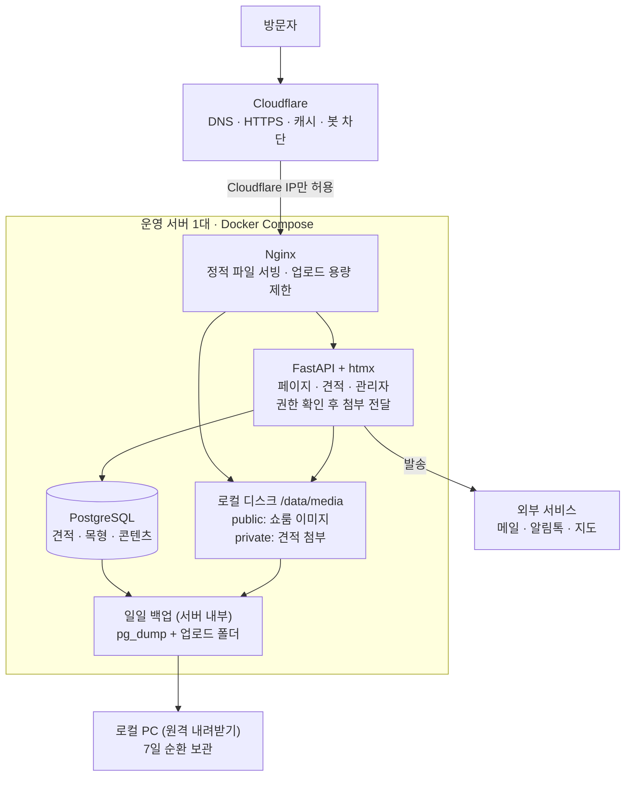

# 좋은상자 홈페이지 개편 기획서

작성일: 2026-11-16

## 1. 개요

goodpackage.co.kr을 WordPress에서 FastAPI + htmx로 옮기며, 서버 1대에 모든 구성을 올리고 Cloudflare를 앞단에 둡니다. 개발은 로컬에서 1차 완성·검증한 뒤 운영 서버에 한 번에 배포합니다.

**목표**

1. 견적 전환율 개선: 견적 폼을 단계형으로 바꾸고 기존 목형을 실시간 추천합니다.
2. 견적의 업무 데이터화: 게시판 글이 아닌 상태가 있는 견적 건(접수 → 검토 → 답변 → 수주/종결)으로 관리합니다.
3. 운영 단순화: 플러그인 9개 의존을 없애고 서버 렌더링 HTML과 최소한의 JS로 구성합니다.
4. 검색 노출 유지: 기존 URL을 그대로 쓰거나 301로 연결합니다.

**범위**

- 포함: 공개 페이지 9종, 견적 접수·열람, 관리자 화면, 기존 데이터 이관(견적 2,815건, 쇼룸 약 37건), 배포·백업 체계
- 제외: 디자인 전면 개편(현 디자인 기조 유지 가정), ERP 등 사내 시스템 연동, 온라인 결제

**전제**

| 항목 | 결정 |
| --- | --- |
| 서버 | 1대에 웹·DB·파일을 모두 구성 |
| 앞단 | Cloudflare 유지 (DNS, HTTPS, 캐시, 봇 차단) |
| 파일 저장 | 서버 로컬 디스크 + 서버 내부 일일 백업 후 로컬 PC로 원격 복사 (7일 순환) |
| 진행 방식 | 1차 로컬 개발·테스트 → 최종 배포 (중간 스테이징 서버 없음) |

이 기획서는 공개 화면 분석에 근거합니다. 관리자 화면, DB, 현재 서버 환경은 확인하지 못했으며 해당 내용은 가정으로 표시했습니다.

## 2. 현재 사이트 진단

현재 사이트는 WordPress + BeTheme에 플러그인 9개가 얹힌 구조이며, 실제 업무 가치는 견적 문의 한 곳에 집중되어 있습니다.

| 현재 URL | 내용 | 개편 후 |
| --- | --- | --- |
| `/` | 히어로, 사업 소개, 8단계 공정, 실시간 문의 3건 | 유지 |
| `/company/` | 회사소개, 조직도, 본사·2공장 약도 | 유지 |
| `/process/` | 제작과정 | 유지 |
| `/facilities/` | 보유장비 | 유지 |
| `/portfolio/` | 쇼룸 그리드, 상세는 `/?p=ID` | 목록 유지, 상세는 `/portfolio/{id}`로 301 |
| `/inquiry/` | 견적문의 폼 (약 25개 항목, 첨부 5개·9MB) | 유지, 단계형으로 재구성 |
| `/list/` | 견적 상담 리스트, 상세는 `/?kboard_content_redirect=ID` | 목록 유지, 상세는 `/list/{id}`로 301 |
| `/notice/`, `/faq/` | 공지(0건), FAQ(2건) | 유지 |

**사용 중인 구성 요소와 대체 방안**

| 현재 | 역할 | 대체 |
| --- | --- | --- |
| KBoard, KBoard 댓글 | 견적 리스트, 공지, FAQ | 자체 견적·게시 기능 |
| Quform | 견적 폼 | Jinja 폼 + htmx 검증 |
| Slider Revolution | 메인 슬라이더 | 정적 히어로 이미지 |
| The Grid | 쇼룸 그리드 | CSS 그리드 + htmx 더 보기 |
| Popup Builder, Cosmosfarm 팝업 | 공지 팝업 | 관리자에서 등록하는 단순 팝업 |
| TapTap, Header Builder | 모바일 메뉴, 헤더 | 템플릿 + Alpine.js |
| AIOSEO | 메타, 사이트맵 | 템플릿 메타 + 자체 sitemap.xml |
| 네이버 지도, 카카오 채널, smlog | 약도, 채팅, 분석 | 그대로 유지 |

**문제점**

- 견적 글의 비밀번호가 문의 시 남긴 전화번호여서 추측이 쉽습니다. 업체명·연락처·예산이 담긴 글이므로 개편 시 반드시 바꿉니다.
- 견적 2,815건이 게시판 글로만 쌓여 상태 관리, 담당자 배정, 통계가 어렵습니다.
- 폼에 "비슷한 규격의 기존 목형 자동 제안" 문구가 있으나 공개 화면에서는 동작을 확인하지 못했습니다.
- 쇼룸에 박스형태·업종 필터가 없고, 공지와 FAQ는 사실상 비어 있습니다.

## 3. 시스템 구성

서버 1대에서 Docker Compose로 Nginx, FastAPI, PostgreSQL을 함께 돌리고, 외부 요청은 Cloudflare를 거쳐서만 들어오게 합니다.



서버는 Cloudflare IP에서 오는 요청만 받고, 견적 첨부는 FastAPI의 권한 확인을 거쳐야만 내려갑니다. DB와 업로드 폴더는 매일 서버 내부에 백업한 뒤 로컬 PC로 원격 복사하며, 7일치를 순환 보관합니다.

**기술 스택**

| 영역 | 선택 | 비고 |
| --- | --- | --- |
| 웹 | FastAPI + Jinja2, Uvicorn | 전체 페이지와 htmx 조각을 같은 템플릿에서 렌더링 |
| 상호작용 | htmx + Alpine.js(소량) | 모바일 메뉴, 아코디언만 Alpine |
| 스타일 | Tailwind CSS | 빌드 결과물만 배포 |
| DB | PostgreSQL 16 + SQLAlchemy 2 + Alembic | 견적 검색은 `pg_trgm` |
| 파일 | 서버 로컬 디스크 (Docker 볼륨) | 공개 이미지와 비공개 첨부를 디렉터리로 분리 |
| 웹서버 | Nginx | 정적 파일 서빙, 업로드 용량 제한, `X-Accel-Redirect` |
| 백그라운드 작업 | FastAPI BackgroundTasks | 메일·알림 발송. 별도 큐 서버 없음 |
| 메일/알림 | SMTP 또는 메일 발송 서비스, 카카오 알림톡(선택) | 접수 확인, 답변 알림 |

**Cloudflare가 맡는 일**

| 기능 | 설정 |
| --- | --- |
| DNS + 프록시 | 웹 레코드는 프록시 켬. 메일 레코드(MX, SPF, DKIM)는 기존 값 유지 |
| HTTPS | SSL 모드 Full (strict), 서버에는 Cloudflare Origin 인증서 설치 |
| 캐시 | `/static/*`, `/media/*`는 장기 캐시. HTML과 `/admin/*`, `/inquiry/*`, `/list/*`는 캐시 안 함 |
| 스팸 방지 | 견적 폼에 Turnstile, 폼 제출 경로에 요청 제한 규칙 |
| 접근 제한 | `/admin/*`에 국가·IP 규칙 또는 Cloudflare Access(선택) |
| 업로드 한도 | 무료 요금제는 요청당 100MB. 현재 한도(5개 × 9MB = 45MB) 이내 |

서버 방화벽은 80/443 포트를 Cloudflare IP 대역에만 열어 우회 접속을 막습니다. 앱은 방문자 IP를 `CF-Connecting-IP` 헤더에서 읽습니다.

**파일 저장**

- `/data/media/public/`: 쇼룸·페이지 이미지. Nginx가 직접 서빙하고 Cloudflare가 캐시합니다.
- `/data/media/private/`: 견적 첨부. 웹에서 직접 접근할 수 없고, FastAPI가 권한 확인 후 내려줍니다.
- 저장 파일명은 무작위 값으로 바꾸고, 확장자·용량은 서버에서 검증합니다.
- 예상 용량은 누적 10GB 안팎, 연 1~3GB 증가입니다(추정). 기존 `wp-content/uploads` 크기를 재면 확정됩니다.

**서버 권장 사양**: 2 vCPU, RAM 4GB, SSD 80GB 이상, Ubuntu LTS, 국내 리전.

## 4. 기능 설계

개발 우선순위는 견적문의 폼, 관리자 견적 화면, 견적 리스트 순이며 나머지 페이지는 정적 템플릿으로 옮깁니다.

### 4.1 견적문의 `/inquiry/`

- 3단계로 나눕니다: ① 제작 사양 → ② 요청 내용·첨부 → ③ 담당자 정보·동의. 가벼운 입력부터 받아 이탈을 줄입니다.
- 박스형태 12종은 라디오 대신 도면 썸네일 카드로 선택합니다.
- 목형 추천: 가로·세로·높이를 입력하면 `hx-get="/inquiry/molds"`, `hx-trigger="input changed delay:400ms"`로 유사 규격 목형을 바로 보여주고, 선택하면 견적에 연결합니다.
- 필드 단위 서버 검증(해당 필드만 교체), 종이재질에 따른 평량 옵션 연동.
- 첨부는 최대 5개·개당 9MB를 유지하고 진행률을 표시합니다.
- 제출 후 접수번호를 발급하고 확인 메일을 보냅니다. 담당자에게도 알림이 갑니다.

### 4.2 견적 상담 리스트 `/list/`

- 공개 목록은 제목, 마스킹된 이름, 상태만 보여줍니다.
- 본문 열람은 전화번호 비밀번호를 없애고 접수번호 + 이메일 인증 링크로 바꿉니다.
- 답변완료 필터, 검색, 페이지 이동은 `hx-get` + `hx-push-url`로 목록만 교체합니다.

### 4.3 그 밖의 공개 페이지

| 페이지 | 설계 |
| --- | --- |
| 메인 | 슬라이더를 정적 히어로로 교체. 실시간 문의 위젯은 `hx-trigger="load, every 60s"` |
| 쇼룸 | 박스형태·업종 필터 추가, 더 보기는 `hx-trigger="revealed"`. 상세에 "이 사양으로 견적 문의" 버튼 |
| 회사소개·제작과정·보유장비 | Jinja 정적 템플릿. 네이버 지도는 화면에 보일 때 로드 |
| 공지·FAQ | FAQ는 아코디언 + 구조화 데이터. 견적에서 반복되는 질문으로 항목 보강 |
| 공통 | 카카오 채널 채팅 버튼, 전화 링크, 팝업 |

### 4.4 관리자 `/admin/`

- 견적: 목록(상태·담당자·기간 필터), 상세에서 답변 작성 후 고객 발송, 내부 메모, 상태 변경, 담당자 배정
- 목형: 등록·수정, 엑셀 일괄 업로드
- 콘텐츠: 쇼룸, 공지, FAQ, 팝업 편집
- 권한: 관리자 / 영업 2단계. 로그인은 세션 쿠키, 비밀번호는 argon2 해시

### 4.5 데이터 모델

| 테이블 | 주요 항목 |
| --- | --- |
| `inquiries` | 접수번호, 업체·담당자 정보, 제목, 내용, 수량, 예산, 상태, 담당 직원, 선택 목형 |
| `inquiry_specs` | 박스형태, 가로/세로/높이, 재질, 평량, 인쇄, 코팅, 박, 형압, 실크 |
| `inquiry_files` | 원본 파일명, 저장 경로, 크기 |
| `inquiry_replies` | 내용, 작성자, 고객 답변/내부 메모 구분 |
| `molds` | 박스형태, 가로/세로/높이, 메모 |
| `portfolio_items` | 이름, 박스형태, 업종, 이미지, 기존 WP 글 ID |
| `notices`, `faqs`, `popups`, `users` | 콘텐츠와 관리자 계정 |

연락처와 이메일은 암호화해 저장하고, 기존 WP 글 ID를 보관해 301 연결에 사용합니다.

## 5. 1차 로컬 개발

로컬에서 운영과 같은 Docker Compose 구성으로 개발하고, 기존 WordPress 데이터를 부어 실제 데이터로 검증한 뒤 배포합니다.

### 5.1 로컬 환경

| 항목 | 로컬 | 운영과의 차이 |
| --- | --- | --- |
| 실행 | `docker compose up` (web, db, nginx) | 동일한 이미지, 설정만 `.env`로 구분 |
| 앱 | Uvicorn `--reload`, 코드 디렉터리 마운트 | 운영은 reload 없이 워커 2~4개 |
| DB | PostgreSQL 16 컨테이너 | 동일 버전 |
| 메일 | Mailpit 컨테이너로 가로채서 확인 | 운영은 실제 발송 |
| Turnstile | Cloudflare 제공 테스트 키 | 운영 키 |
| 알림톡, 카카오·네이버 지도 | 알림톡은 로그 출력으로 대체, 지도는 개발용 도메인 등록 | 운영 키 |
| 도메인 | `http://localhost:8000` | Cloudflare 경유 HTTPS |

### 5.2 프로젝트 구조

```
goodpackage/
  app/
    main.py            # 앱 생성, 라우터 등록
    config.py          # .env 설정
    models/            # SQLAlchemy 모델
    routers/           # pages, inquiry, board, portfolio, admin
    services/          # mold_match, mailer, storage, auth
    templates/         # base, pages, partials(htmx 조각), admin
    static/            # css, js(htmx, alpine), 이미지
  migrations/          # Alembic
  scripts/
    wp_import.py       # WordPress → 신규 DB 이관
    backup.sh
  tests/
  deploy/
    nginx.conf
    docker-compose.yml
    docker-compose.prod.yml
  .env.example
```

### 5.3 개발 순서

1. 기반: 저장소, Compose, DB 마이그레이션, 공통 레이아웃(헤더·푸터·모바일 메뉴)
2. 정적 페이지: 메인, 회사소개, 제작과정, 보유장비
3. 쇼룸: 목록·필터·상세
4. 견적문의: 단계형 폼, 검증, 첨부, 목형 추천, 접수 메일
5. 관리자: 로그인, 견적 처리, 목형·콘텐츠 관리
6. 견적 리스트: 공개 목록, 인증 링크 열람
7. 공지·FAQ, 팝업, SEO(메타, sitemap, 301 규칙)
8. 이관 스크립트: WP DB 덤프와 `uploads` 폴더를 로컬에 받아 변환

### 5.4 데이터 이관 (로컬에서 먼저 완성)

- 입력: 현재 서버의 MySQL 덤프와 `wp-content/uploads` 사본
- 견적 2,815건: KBoard 테이블(글, 옵션, 첨부, 댓글)을 `inquiries`, `inquiry_specs`, `inquiry_files`, `inquiry_replies`로 변환
- 쇼룸: WP 글과 대표 이미지를 추출해 WebP로 변환하고 박스형태 태그 부여
- 기존 글의 전화번호 비밀번호는 옮기지 않고 이메일 인증으로 통일
- 스크립트는 여러 번 돌려도 같은 결과가 나오게 만들어, 배포 당일 최신 덤프로 다시 실행합니다.

## 6. 테스트

스테이징 서버가 없으므로, 로컬에서 운영용 Compose 설정으로 띄운 환경이 배포 전 마지막 검증 장소입니다. 아래 네 가지를 모두 통과해야 배포합니다.

| 구분 | 도구 | 확인 내용 |
| --- | --- | --- |
| 단위·통합 테스트 | pytest + httpx | 목형 추천 계산, 폼 검증, 첨부 제한, 권한(타인 견적·첨부 접근 차단), htmx 조각 응답 |
| 화면 흐름 테스트 | Playwright | 견적 접수 전 과정, 인증 링크 열람, 관리자 답변 발송, 모바일 화면 |
| 이관 리허설 | `wp_import.py` | 건수 일치(견적 2,815건 기준), 첨부 파일 열림, 한글 깨짐 없음, 무작위 30건 원본 대조 |
| 운영 구성 점검 | `docker-compose.prod.yml`로 로컬 기동 | Nginx 경유 동작, 비공개 첨부 직접 접근 차단, 백업·복구 1회 실행 |

**배포 전 점검표**

- [ ] 기존 URL 9종이 같은 주소로 열림
- [ ] `/?p=ID`, `/?kboard_content_redirect=ID`가 새 상세 주소로 301 연결됨
- [ ] 견적 접수 시 고객 확인 메일과 담당자 알림이 발송됨
- [ ] 9MB 파일 5개 첨부가 성공하고, 한도 초과와 금지 확장자는 거부됨
- [ ] 인증 없이는 견적 본문과 첨부에 접근할 수 없음
- [ ] 이관 건수와 첨부 파일 수가 원본과 일치함
- [ ] 주요 페이지가 모바일(375px)과 데스크톱에서 깨지지 않음
- [ ] 페이지별 제목·설명 메타, sitemap.xml, robots.txt가 출력됨
- [ ] 백업 파일로 빈 환경에 복구가 됨
- [ ] 영업 담당자가 관리자 화면에서 견적 1건을 끝까지 처리해 봄

로컬에서 확인할 수 없는 항목은 Cloudflare 경유 동작(캐시 규칙, Turnstile 운영 키, 방문자 IP)과 실제 메일 도달입니다. 이 항목은 7장의 사전 점검 단계에서 임시 주소로 확인합니다.

## 7. 최종 배포

새 서버를 미리 완성해 임시 주소로 점검한 뒤, Cloudflare에서 원본 서버 IP만 바꾸는 방식으로 전환합니다. 전환은 문의가 적은 주말 또는 평일 저녁에 하고, 중단 시간은 30분 이내를 목표로 합니다.

### 7.1 서버 준비 (전환 전)

1. 새 서버에 Docker 설치, 방화벽 설정(SSH는 관리 IP만, 80/443은 Cloudflare IP 대역만)
2. Cloudflare Origin 인증서 설치, 운영용 `.env` 작성(DB 비밀번호, 세션 키, 메일·Turnstile 키)
3. 저장소를 내려받아 `docker compose -f deploy/docker-compose.prod.yml up -d`로 기동, DB 마이그레이션 적용
4. 이관 1차 실행(그 시점의 WP 덤프 기준)
5. 임시 주소(예: `new.goodpackage.co.kr`)를 Cloudflare에 등록해 사전 점검. 검색엔진 노출을 막기 위해 접근 제한을 겁니다.
6. 사전 점검: 캐시 규칙, Turnstile, 방문자 IP 기록, 실제 메일 도달, 백업 자동 실행

### 7.2 전환 당일

1. 기존 WordPress의 견적 폼을 닫고 점검 안내를 띄웁니다(전화·카카오 채널 안내 포함).
2. 최신 WP DB 덤프와 `uploads` 변경분을 받아 이관 스크립트를 다시 실행합니다.
3. 건수를 대조합니다.
4. Cloudflare DNS의 웹 레코드를 새 서버 IP로 바꿉니다. 프록시를 거치므로 수 분 내에 반영됩니다.
5. Cloudflare 캐시를 전체 삭제합니다.
6. 운영 주소에서 6장 점검표를 다시 확인하고, 실제 견적 1건을 접수해 봅니다.
7. 네이버 서치어드바이저와 구글 서치콘솔에 사이트맵을 다시 제출합니다.

### 7.3 롤백

- 기준: 전환 후 1시간 내 견적 접수 불가, 데이터 누락, 주요 페이지 오류가 해결되지 않을 때
- 방법: Cloudflare DNS를 기존 서버 IP로 되돌리고 WP 견적 폼을 다시 엽니다. 수 분 내 복구됩니다.
- 그 사이 새 서버에 접수된 견적은 담당자에게 수동 전달합니다.
- 기존 WordPress 서버는 전환 후 2~4주간 그대로 보존한 뒤 백업하고 종료합니다.

### 7.4 운영

| 항목 | 방식 |
| --- | --- |
| 백업 | 매일 새벽 `pg_dump` + 업로드 폴더를 서버 내부에 백업 → 로컬 PC가 원격으로 내려받아 저장. 양쪽 모두 7일 순환 보관, 분기 1회 복구 연습 |
| 모니터링 | 외부 가동 감시(무료 서비스)로 `/healthz` 확인, 디스크 80% 알림, 오류 로그 알림 |
| 업데이트 배포 | 로컬 테스트 통과 → 서버에서 최신 코드 내려받기 → 이미지 재빌드 → 마이그레이션 → 재기동. 스크립트 1개로 고정 |
| 보안 | OS 자동 보안 업데이트, SSH 키 로그인만 허용, 관리자 로그인 실패 제한 |
| 로그 | 컨테이너 로그 용량 제한과 보관 기간 설정 |

**백업 절차**

1. 매일 새벽 3시, 서버가 `/data/backup/날짜/`에 DB 덤프(`pg_dump`, 압축)와 업로드 폴더 사본을 만듭니다.
2. 업로드 폴더는 증분 방식(rsync 하드링크)으로 복사합니다. 바뀐 파일만 새로 저장되므로 7일치를 두어도 디스크는 원본의 1배 남짓만 씁니다.
3. 8일째가 되는 가장 오래된 날짜 폴더를 삭제해 항상 7일치만 남깁니다.
4. 로컬 PC의 예약 작업이 매일 SSH(rsync 또는 scp)로 서버에 접속해 새 백업을 내려받고, PC에서도 7일치만 남깁니다.
5. PC가 꺼져 있던 날은 다음 실행 때 밀린 날짜를 함께 받습니다. 서버에 7일치가 있으므로 7일 안에만 켜지면 빠짐이 없습니다.

복사는 서버가 보내는 방식이 아니라 PC가 가져오는 방식입니다. PC에는 고정 IP가 필요 없고, 서버에는 백업 폴더 읽기 전용 계정만 열어 둡니다. PC가 8일 이상 꺼져 있거나 내려받기에 실패하면 알림이 가도록 합니다.

서버가 1대이므로 장애 시 복구 수단은 백업입니다. 백업에서 새 서버를 세우는 데 걸리는 시간을 연습으로 측정해 둡니다.

## 8. 일정, 위험 요소, 확정 필요 사항

전체 기간은 약 9~10주로 추정하며(개발 1~2인, 현 디자인 유지 기준), 이 중 8주가 로컬 개발·테스트입니다.

| 단계 | 기간 | 장소 | 산출물 |
| --- | --- | --- | --- |
| 1. 요구 확정·설계 | 1주 | - | 화면 설계, DB 설계, WP 덤프 확보 |
| 2. 기반·정적 페이지·쇼룸 | 2주 | 로컬 | 레이아웃, 메인, 소개 페이지, 쇼룸 |
| 3. 견적문의·목형 추천 | 2주 | 로컬 | 단계형 폼, 첨부, 알림 |
| 4. 관리자·견적 리스트 | 2주 | 로컬 | 견적 처리 화면, 인증 열람, 콘텐츠 편집 |
| 5. 이관·통합 테스트 | 1주 | 로컬 | 이관 리허설, 6장 점검표 통과 |
| 6. 서버 준비·사전 점검 | 3~4일 | 운영 서버 | 임시 주소 점검 완료 |
| 7. 전환 | 1일 | 운영 서버 | 오픈 |
| 8. 안정화 | 2주 | 운영 서버 | 오류 수정, 기존 서버 종료 |

**위험 요소**

| 위험 | 대응 |
| --- | --- |
| 스테이징이 없어 운영 환경 문제를 늦게 발견 | 로컬에서 운영용 Compose로 검증하고, 전환 전 임시 주소로 사전 점검 |
| 서버 1대 장애 시 전체 중단 | 서버 내부 백업 + 로컬 PC 원격 복사(7일 순환), 복구 연습, 가동 감시 알림 |
| KBoard 데이터 구조가 예상과 다름 | 1단계에서 덤프를 먼저 받아 구조 확인 |
| 목형 데이터가 정리되어 있지 않음 | 추천 기능을 오픈 후 2차로 미루고, 폼은 먼저 열기 |
| 전환 후 검색 유입 감소 | URL 유지, 301 전수 점검, 사이트맵 재제출 |
| 접수 메일이 스팸함으로 감 | 발송 도메인 SPF·DKIM 설정, 사전 점검에서 주요 메일 서비스로 도달 확인 |

**확정 필요 사항**

- [ ] 목형 데이터의 현재 보관 형태(엑셀, ERP 등)와 건수
- [ ] 견적 리스트를 계속 공개할지 (권장: 제목·상태만 공개)
- [ ] 새 서버를 둘 호스팅 업체와 사양
- [ ] 현재 서버의 DB 덤프·`uploads` 접근 권한과 Cloudflare 계정 권한
- [ ] 메일 발송 방식과 카카오 알림톡 도입 여부
- [ ] 디자인을 유지할지 새로 할지 (새로 하면 일정 3~4주 추가 추정)
- [ ] 개인정보 보유기간(현재 고지 10년) 재검토
- [ ] 전환 희망 시기
